# 5.4. Sales flow: cart and orders that are never lost or duplicated

Author: Hoàng · Draft 24/11/2026

This chapter walks you through rebuilding the shop-ai sales flow: adding to the cart, placing an order with an `Idempotency-Key`, the order travelling through an SQS queue to a worker that confirms it and sends an SES email, cancelling an order to restock, and an admin moving the order through delivery. It focuses on two questions: **can an order be lost when part of the system fails**, and **does clicking "place order" twice create two orders**. Finish 5.1 Introduction, 5.2 Prerequisite and 5.3 Infrastructure first: the sandbox stacks `shop-sbx-<name>-api` and `shop-sbx-<name>-web` must be deployed to your account. In this chapter `<name>` is the value you used in `-c owner=<name>` when deploying.

## Goals

After this chapter you will:

- Understand the path of one order: web → API Gateway → `ordering` Lambda → DynamoDB (one transaction) → SQS → worker Lambda → SES and SNS.
- See why stock is never decremented wrongly: decrementing stock, writing the order and removing the items from the cart happen in **one** `TransactWriteItems`, and every stock decrement has the condition `stock >= quantity`.
- Try `Idempotency-Key`: resending the same key returns the same order, never a second one.
- Pause the worker, then resume it, and see the order wait in the queue instead of being lost.
- Cancel an order and see stock added back exactly once, and move an order through delivery with an admin account.

## Sales flow architecture

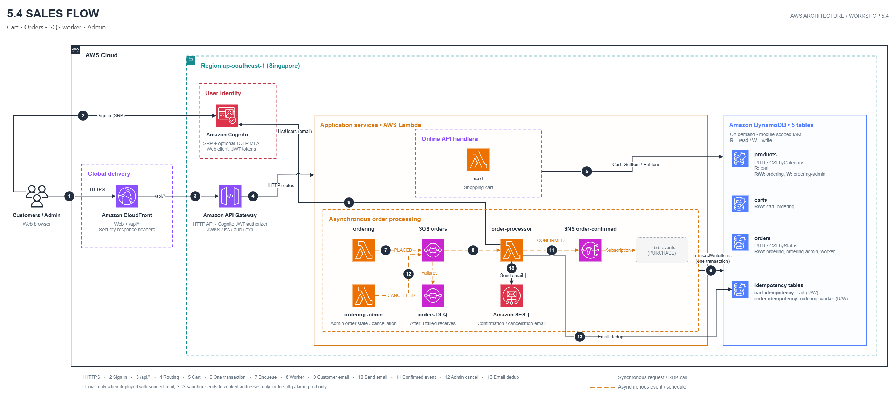
*Figure 01. Sales flow diagram: Web (CloudFront) → API Gateway (Cognito JWT) → `ordering` Lambda → DynamoDB `products`, `carts`, `orders`, `order-idempotency` (one transaction) → SQS orders queue (DLQ after 3 failures) → `order-processor` Lambda → SES (customer email) and SNS `order-confirmed` → the `events` module's SQS queue; the admin Lambda reads the `byStatus` index of `orders`.*
[draw.io source](images/5.4/01-so-do.drawio)

| Component | Purpose | Notable settings (`infra/lib/api-stack.ts`) |
|---|---|---|
| `carts` table | One cart per customer (key `userId`), the item list in one item | On-demand; conditional writes on `version` so two tabs editing the cart don't overwrite each other |
| `orders` table | Orders (key `userId` + `orderId`, a ULID) | `byStatus` index for admin; the same table holds a `#OPEN` counter item (at most 3 open orders) and a `#KEY#<Idempotency-Key>` marker item with TTL `expiresAt`; point-in-time recovery on |
| `order-idempotency` table | Powertools Idempotency records against double processing | Key `id`, TTL `expiration` (24 hours) |
| `ordering` Lambda | `POST/GET /api/v1/orders`, `GET/DELETE /api/v1/orders/{orderId}` | 512 MB, 10 s timeout, may write only the tables it needs |
| Orders queue (SQS) | New and cancelled orders waiting for the worker | SQS-managed encryption, TLS only, 60 s visibility timeout, after **3 failures** a message moves to the DLQ (kept 14 days) |
| `order-processor` Lambda (worker) | Confirms orders, sends emails, publishes `order-confirmed` | 256 MB, 10 s timeout, up to 5 messages per batch, reports failures per message (`reportBatchItemFailures`), at most 2 concurrent instances (to pace SES sandbox) |
| Admin Lambda | `GET/PATCH/DELETE /api/v1/admin/orders…` | Only the Cognito `admin` group may call it (checked in the backend, 403 otherwise) |

Order state machine (`docs/business/ordering.md`):

```text
PENDING ──► CONFIRMED ──► SHIPPED ──► DELIVERED
   │            │            │
   └────────────┴────────────┴──► CANCELLED (restock)
```

The API sets `PENDING`, the worker sets `CONFIRMED`, the admin sets `SHIPPED` and `DELIVERED`. Customers can cancel in `PENDING` or `CONFIRMED`; admins can also cancel in `SHIPPED`.

## Preparation

- 5.2 Prerequisite done (AWS CLI, Node, pnpm, shop-ai repo) and 5.3 done (both sandbox stacks deployed).
- An account registered on your web app (URL in the `WebUrl` output of `shop-sbx-<name>-web`).
- `jq` to read JSON in the commands below (Git Bash on Windows: download `jq` from its official site and add it to `PATH`).
- Read the API stack outputs you need:

```bash
STACK=shop-sbx-<name>-api
aws cloudformation describe-stacks --stack-name "$STACK" \
  --query "Stacks[0].Outputs[?OutputKey=='ApiUrl' || OutputKey=='OrdersTableName' || OutputKey=='OrdersQueueUrl' || OutputKey=='UserPoolId' || OutputKey=='UserPoolE2eClientId'].[OutputKey,OutputValue]" \
  --output text \
  | sed -E 's/[0-9]{12}/<account-id>/g; s/(ap-southeast-1_)[A-Za-z0-9]+/\1xxxxxxxx/g' \
  | awk -F'\t' '{printf "%-21s %s\n", $1, $2}'
```

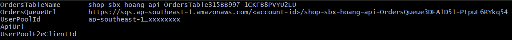
*Figure 02. The API stack outputs; the command replaced the account ID with `<account-id>` and masked the user pool ID.*

### Turn on SES email for the worker

The worker sends email only when the deploy passes a sender address (`-c senderEmail`); without it the worker skips the email step and everything else still runs. A new SES account is in the **sandbox**: it can send only to verified addresses, at most 1 email per second. For this lab, the simplest setup is to use **the same address** as the sender and as the email of your web account.

1. Verify the address (not done in CDK because the identity is account-wide; deleting the stack would remove it):

   ```bash
   aws sesv2 create-email-identity --email-identity <your email> --region ap-southeast-1
   ```

   Open your inbox and click the AWS verification link.
2. Console → **Amazon SES** → **Identities**: the address shows **Verified**.
3. Build the web app and redeploy the API stack with the sender address:

   ```bash
   pnpm --filter web build
   pnpm --filter infra exec cdk deploy shop-sbx-<name>-api -c env=sbx -c owner=<name> -c senderEmail=<your email>
   ```

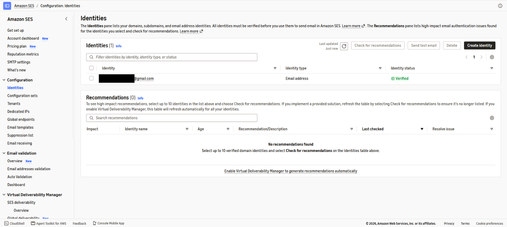
*Figure 03. The identity shown as Verified in SES.*

## Step 1: Add to cart

**Goal:** see that a signed-in customer's cart is stored on the server, and that a guest cart is merged in at sign-in.

1. Open the web app **signed out**, open an in-stock product, click **Thêm vào giỏ** (Add to cart). The guest cart lives in the browser (localStorage).
2. Sign in. The web app calls `POST /api/v1/cart/merge` (with an `Idempotency-Key`) to merge the guest cart into the account cart, then clears the guest cart.
3. Add another product and open **Giỏ hàng** (Cart).

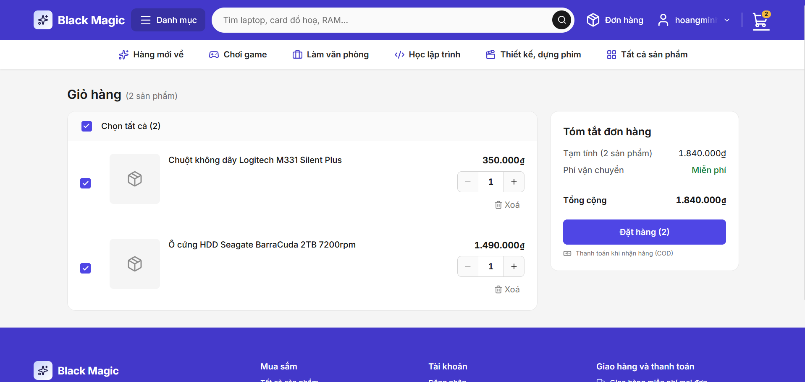
*Figure 04. Cart page with 2 products, signed in.*

**Check:** Console → **DynamoDB** → the `...CartsTable...` table of `shop-sbx-<name>-api` → **Explore items**. There is one item whose `userId` is your Cognito `sub`, with an `items` list of `{ productId, quantity, addedPrice, addedAt }` and a `version`.

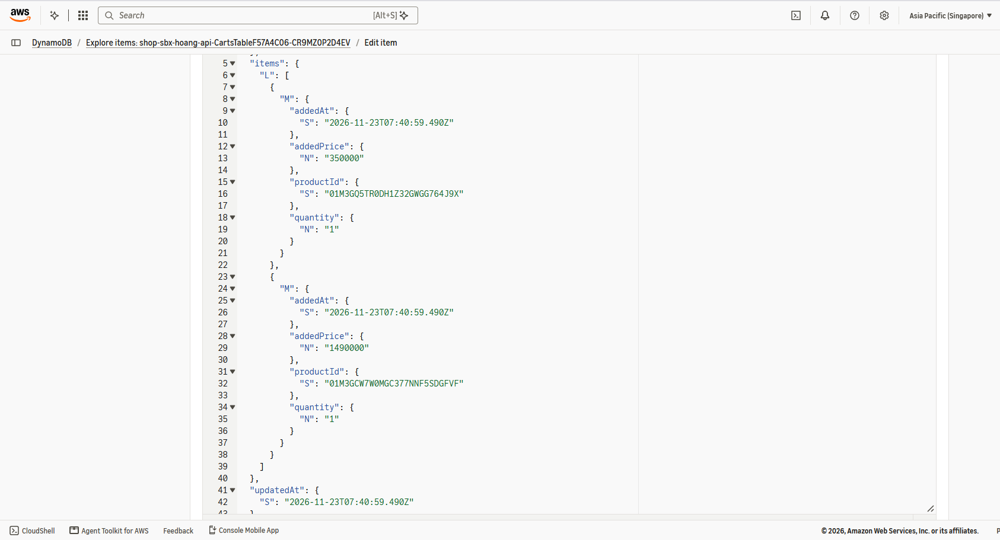
*Figure 05. The cart item in the `carts` table.*

## Step 2: Place an order

**Goal:** create an order and see what one DynamoDB transaction writes.

1. In the cart, tick 1 product (leave the other), click **Đặt hàng** (Place order). The checkout page shows the chosen item and free shipping.
2. Fill in name, phone, address and province (fake data), click **Xác nhận đặt hàng** (Confirm order).
3. The web app opens the order detail page. The status starts as "Chờ xác nhận" (`PENDING`); reload a few seconds later and it shows "Đã xác nhận" (`CONFIRMED`), set by the worker.

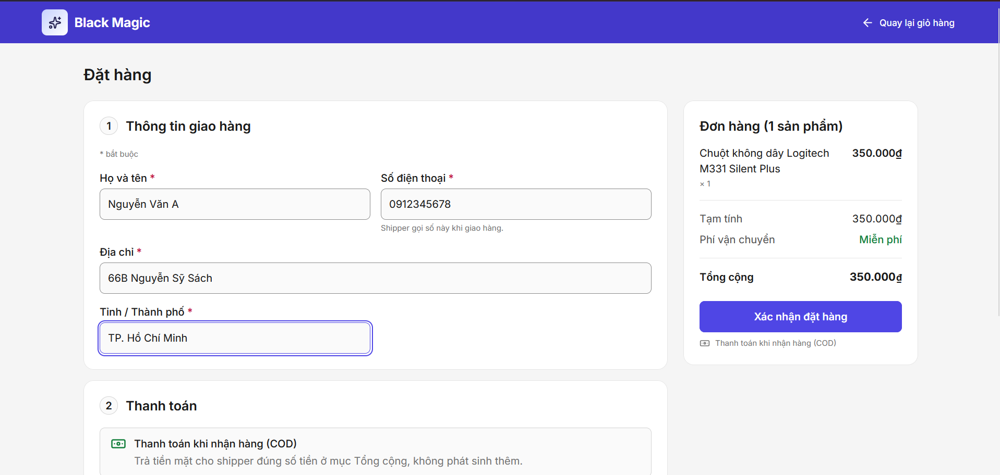
*Figure 06. The checkout page before confirming (fake data).*

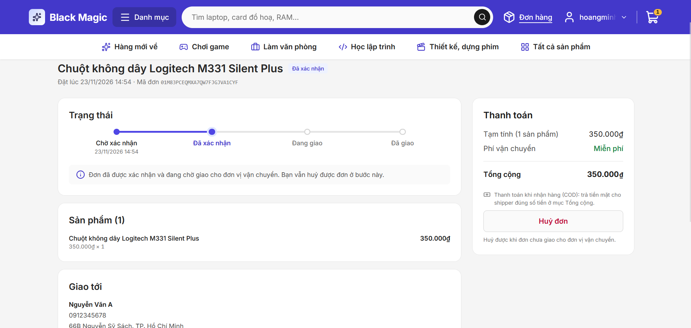
*Figure 07. The order detail page showing "Đã xác nhận".*

**Check in DynamoDB:**

1. `...OrdersTable...` → **Explore items**, filter `userId` = your `sub`. There are three kinds of items:
   - the order (`orderId` is a ULID; `status`; `items` is a snapshot of name, price and quantity at order time; `totalAmount`; `shippingAddress`);
   - the `#OPEN` counter with `openOrders` = 1 (open orders, at most 3);
   - the `#KEY#<Idempotency-Key>` marker with `refOrderId` pointing at the order and `expiresAt` (24-hour TTL).
2. `...ProductsTable...`: the ordered product's `stock` went down by exactly the quantity.
3. `...CartsTable...`: only the ordered item was removed from the cart; the unticked one is still there.

All of these changes (decrementing stock, writing the order, removing the item from the cart, incrementing `#OPEN`, writing the marker) happen in **one** `TransactWriteItems`: either all of them happen or nothing changes. The stock decrement has the condition `stock >= quantity`, so when two customers buy the last unit at the same time only one succeeds; the other gets 409 `OUT_OF_STOCK` and stock never goes negative.

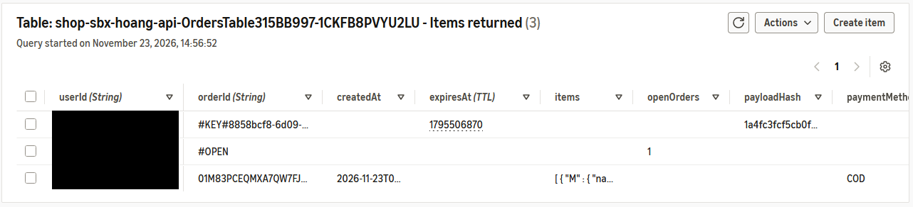
*Figure 08. The three items in `orders`: the order, `#OPEN`, `#KEY#…`.*

## Step 3: Click twice, still one order (`Idempotency-Key`)

**Goal:** send the same order request twice with the same `Idempotency-Key` and get exactly one order back.

The web app generates a UUID for each checkout and sends **the same UUID** again when the customer retries after a network error. Here we call the API directly to see it clearly.

1. Get an access token with the E2E app client (exists in sandbox, dev and staging only; never in prod). The password is read with `read -s` so it is not saved in your shell history:

   ```bash
   API=<ApiUrl>
   CLIENT=<UserPoolE2eClientId>
   read -rp "Email: " EMAIL; read -rsp "Password: " PW; echo
   TOKEN=$(aws cognito-idp initiate-auth --region ap-southeast-1 --client-id "$CLIENT" \
     --auth-flow USER_PASSWORD_AUTH --auth-parameters "USERNAME=$EMAIL,PASSWORD=$PW" \
     --query AuthenticationResult.AccessToken --output text); unset PW
   ```

2. Pick an in-stock product and its current price:

   ```bash
   P=$(curl -s "$API/api/v1/products?limit=20" | jq -c '[.items[] | select(.stock > 0)][0] | {productId, price}')
   echo "$P"
   ```

3. Build the request body and a key, then send it **twice** with the same key. The key command adds `command` so Git Bash does not run `node` through winpty (which fails when the output is captured into a variable):

   ```bash
   KEY=$(command node -e "console.log(crypto.randomUUID())")
   BODY=$(jq -n --argjson p "$P" '{
     items: [{ productId: $p.productId, quantity: 1, expectedPrice: $p.price }],
     shippingAddress: { fullName: "Test Customer", phone: "0912345678", address: "1 Test Street", province: "Ha Noi" }
   }')
   for i in 1 2; do
     curl -s -w '\n%{http_code}\n' -X POST "$API/api/v1/orders" \
       -H "Authorization: Bearer $TOKEN" -H "Content-Type: application/json" \
       -H "Idempotency-Key: $KEY" -d "$BODY" |
       { read -r body; read -r code; echo "HTTP $code orderId=$(echo "$body" | jq -r .orderId)"; }
   done
   ```

**Expected:** the first call returns `HTTP 201`, the second `HTTP 200` with **the same `orderId`**. The `orders` table has only one new order; `stock` went down by 1 only.

4. Send the same key again but change `quantity` to 2: you get `422` with code `IDEMPOTENCY_KEY_REUSED` (same key, different content is a client error; no order is created).

   ```bash
   BODY2=$(echo "$BODY" | jq '.items[0].quantity = 2')
   curl -s -w '\n%{http_code}\n' -X POST "$API/api/v1/orders" \
     -H "Authorization: Bearer $TOKEN" -H "Content-Type: application/json" \
     -H "Idempotency-Key: $KEY" -d "$BODY2" |
     { read -r body; read -r code; echo "HTTP $code code=$(echo "$body" | jq -r .code)"; }
   ```

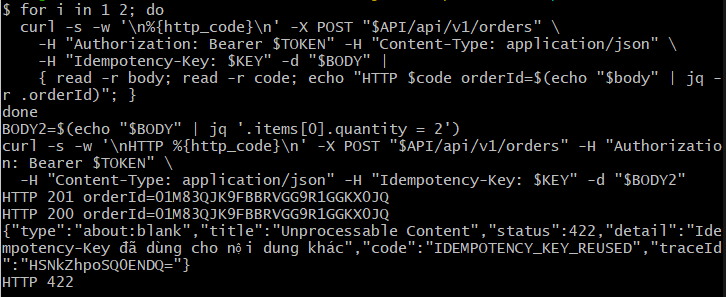
*Figure 09. The two calls (201 then 200, same `orderId`) and the different-content call (422).*

How the server does it (ADR-0017, `docs/business/ordering.md` BR-04): Powertools Idempotency stores the result per key in `order-idempotency` for 24 hours; on top of that, the `#KEY#…` marker is written **in the same transaction** as the order, so even if the Lambda is cut off right after the transaction succeeds, a retry still finds the existing order instead of creating a new one.

> You just created a real order in your sandbox. Cancel it in step 7 or on the web app (`/orders`) to restock. Each account can have at most 3 open orders; a 4th gets 409 `TOO_MANY_OPEN_ORDERS`.

## Step 4: A changed price creates no order

**Goal:** see that the server does not trust the price sent by the client.

Resend the request from step 3 with a wrong `expectedPrice` and a new key:

```bash
KEY=$(command node -e "console.log(crypto.randomUUID())")
BAD=$(echo "$BODY" | jq '.items[0].expectedPrice -= 1000')
curl -s -X POST "$API/api/v1/orders" -H "Authorization: Bearer $TOKEN" \
  -H "Content-Type: application/json" -H "Idempotency-Key: $KEY" -d "$BAD" | jq
```

**Expected:** `409`, `code` is `PRICE_CHANGED`, and `changedItems` has `expectedPrice` (what you sent) and `currentPrice` (the real price). No new order, stock unchanged. On the web app, the checkout page shows the new price so the customer can review and confirm again.

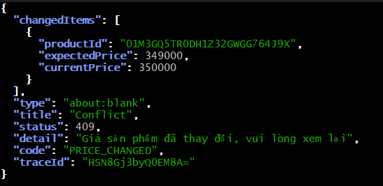
*Figure 10. The 409 `PRICE_CHANGED` response.*

Other business errors of `POST /api/v1/orders` (all `application/problem+json`):

| Code | When |
|---|---|
| `OUT_OF_STOCK` (409) | An item lacks stock or is no longer sold, with `invalidItems` |
| `TOO_MANY_OPEN_ORDERS` (409) | The account already has 3 `PENDING`/`CONFIRMED` orders |
| `ORDER_IN_PROGRESS` (409) | The previous call with the same key has not finished; retry with the same key after a few seconds |
| `IDEMPOTENCY_KEY_REUSED` (422) | Same key, different content |
| (400) | Missing `Idempotency-Key` or invalid body |

## Step 5: No lost orders when the worker stops

**Goal:** see SQS keep an order while the worker is paused, and the worker continue when resumed.

The API only writes the `PENDING` order and pushes `{ orderId, userId, type: "PLACED", correlationId }` to the queue (`type` is `CANCELLED` for a cancelled order); the customer gets a response right away without waiting for the email. The worker does the rest later.

1. Console → **Lambda** → function `shop-sbx-<name>-api-OrderProcessorFunction…` → **Configuration** → **Triggers** → select the SQS trigger → **Edit** → untick **Activate trigger** → **Save**.
2. Place an order on the web app. The order detail page stays at "Chờ xác nhận", even after reloading.
3. Console → **SQS** → queue `…-OrdersQueue…` → **Send and receive messages** → **Poll for messages**. Open the message: the body has only `orderId`, `userId`, `type` (`PLACED`), `correlationId`, no address or phone number; `correlationId` is also in the **Attributes** tab (a message attribute).
   Note: polling hides the message for 60 seconds (visibility timeout); **do not click Delete**.
4. Turn the trigger back on (**Activate trigger** → **Save**). Within a minute the order shows "Đã xác nhận" and the confirmation email arrives.

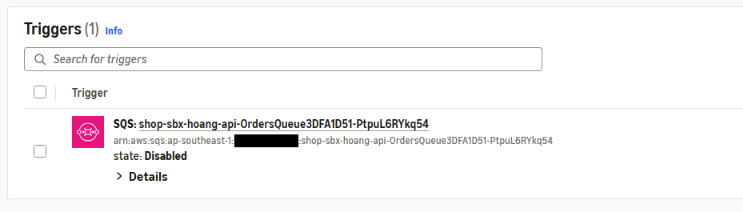
*Figure 11. The SQS trigger shown as Disabled.*

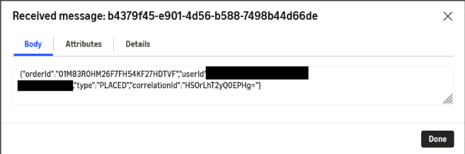
*Figure 12. The message in the orders queue while the worker is off.*

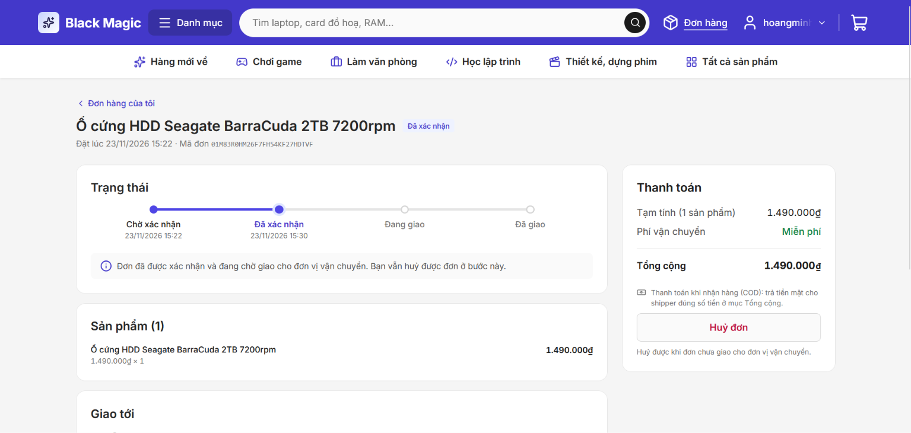
*Figure 13. The order switching to "Đã xác nhận" after the trigger is back on.*

**Check the worker log:** **CloudWatch** → **Logs Insights**, log group `…-OrderProcessorLogs…`:

```text
fields @timestamp, level, message, orderId
| filter correlationId = "<correlationId from the message in step 3>"
| sort @timestamp asc
```

The `correlationId` flows from the API to the worker; the log has no email, phone number or address.

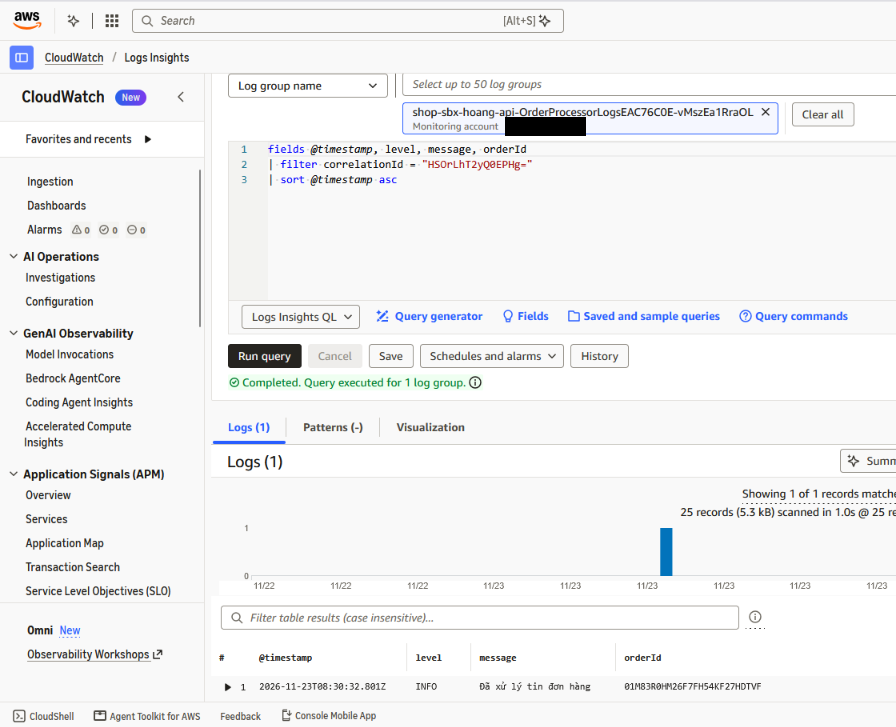
*Figure 14. The worker's Logs Insights result.*

If one message fails 3 times in a row (e.g. a wrong IAM permission, an SNS error), SQS moves it to `…-OrdersDeadLetterQueue…` and the order stays `PENDING`, not lost. Step-by-step handling is in `docs/runbooks/dlq-orders.md`. In prod, the `orders-dlq` alarm fires when the DLQ has a message.

## Step 6: The confirmation email is sent exactly once

**Goal:** see the confirmation email and the duplicate-send protection.

1. Open the inbox of the verified address: there is a confirmation email with the order ID, name × quantity, total, cash on delivery, free shipping. It deliberately has no name, address, phone number or link.
2. `...OrderIdempotencyTable...` table → **Explore items**: there is a new item whose `id` starts with the worker function name (`…OrderProcessorFunction…`), with `status` = `COMPLETED` and `expiration` (24 hours later). The email's dedup key is the `userId` plus `<orderId>#CONFIRMED`; Powertools stores the key as a hash, so the order ID is not readable in `id`. SQS delivers "at least once", so the worker may receive the same message twice; the second time it finds this `COMPLETED` record and does not send the email again.

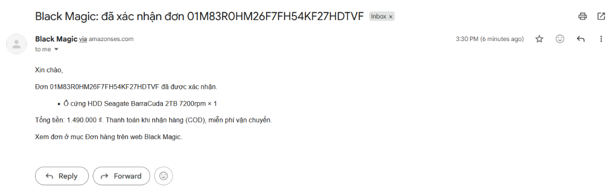
*Figure 15. The order confirmation email.*

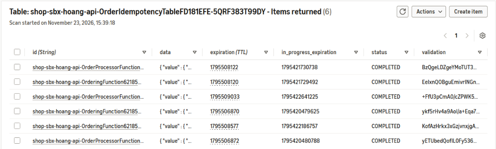
*Figure 16. The worker's item in `order-idempotency` (`id` starting with `…OrderProcessorFunction…`, `status` = `COMPLETED`).*

The worker works in this order (`docs/business/ordering.md`, SQS flow):

1. Change `PENDING → CONFIRMED` with a conditional write `status = PENDING` (skipped if the order was cancelled).
2. Publish `order-confirmed` to SNS (only `orderId`, `userId`, confirmation time, `productId` and quantity) so the recommendation module records the purchase.
3. Send the email through SES, deduplicated by Powertools Idempotency.

If SES rejects the email (e.g. the recipient is not verified in the sandbox), the worker logs a warning and the `OrderEmailRejected` metric, does not retry and does not send the message to the DLQ: the order is still confirmed normally.

## Step 7: Cancel an order, restock exactly once

**Goal:** see cancelling restock in the same transaction, and never twice.

1. Web app → **Đơn hàng** (Orders) → open an order in "Đã xác nhận" → **Huỷ đơn** (Cancel order) → confirm in the dialog.
2. The order shows "Đã huỷ" (Cancelled). A few seconds later a cancellation email arrives (sent by the worker, dedup key `<orderId>#CANCELLED`).
3. Check: the product's `stock` in `products` was added back; `openOrders` in the `#OPEN` item went down by 1.
4. Cancel again through the API:

   ```bash
   curl -s -X DELETE "$API/api/v1/orders/<orderId>" -H "Authorization: Bearer $TOKEN" | jq
   ```

   It returns `409` with code `CANNOT_CANCEL`; stock is not added back a second time (the cancel transaction is conditional on the current status).

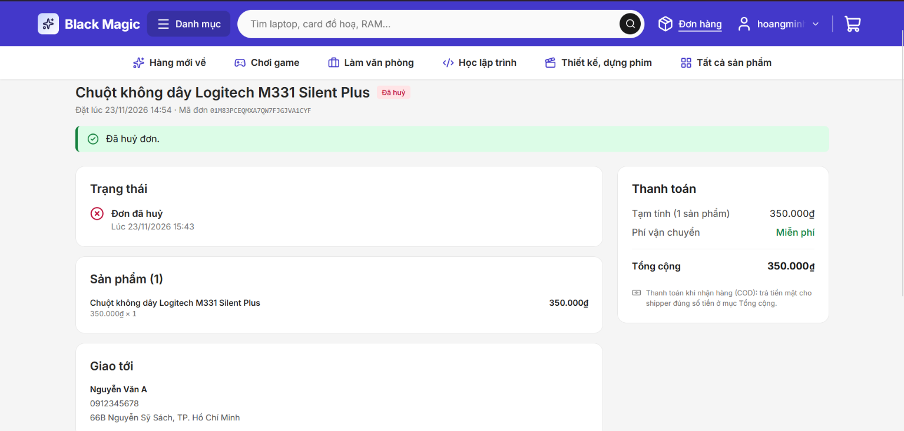
*Figure 17. The cancelled order detail page.*

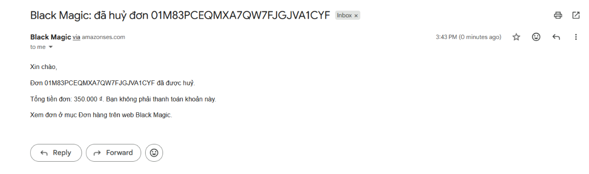
*Figure 18. The cancellation email.*

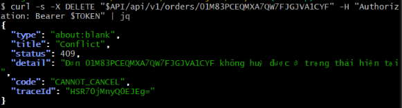
*Figure 19. The 409 `CANNOT_CANCEL` response on the second cancel.*

## Step 8: Admin moves the order through delivery

**Goal:** use an admin account to move an order `CONFIRMED → SHIPPED → DELIVERED`.

1. Add your account to the `admin` group (the group already exists in the user pool):

   ```bash
   aws cognito-idp admin-add-user-to-group --region ap-southeast-1 \
     --user-pool-id <UserPoolId> --username <your email> --group-name admin
   ```

   If the command returns `UserNotFoundException`, pass your `userId` (the account's `sub`) to `--username` instead of the email.

2. Sign out and sign back in on the web app so the new token carries the `admin` group. The account menu now shows "Trang quản trị" (Admin page).
3. Open `/admin`. Admin accounts must turn on two-factor authentication: if it is off, the web app sends you to the setup page; follow it (scan the QR code with an authenticator app), then return to `/admin`.
4. Place a new order (with a normal account or this one) and wait for "Đã xác nhận".
5. Tab **Chờ giao** (Awaiting shipment) → **Chuyển sang Đang giao** (Move to shipping) → confirm. The order moves to the **Đang giao** tab; `openOrders` goes down by 1 (the goods have left the warehouse, so the customer can order again).
6. Tab **Đang giao** → **Đã giao** (Delivered). The customer's order page shows "Đã giao".

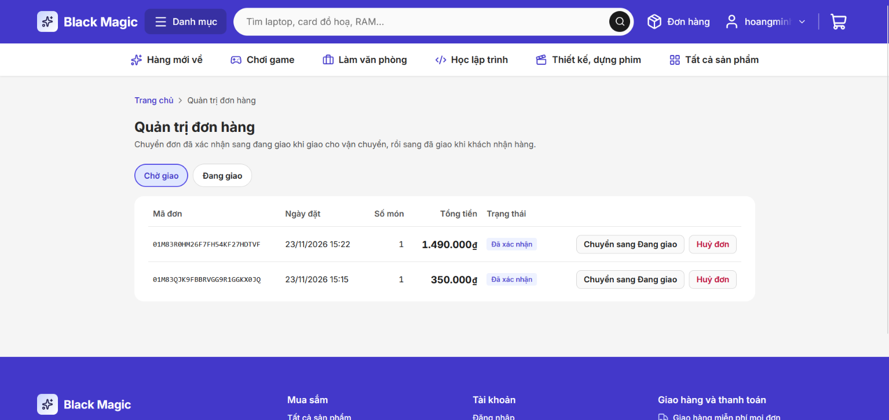
*Figure 20. The `/admin` page, Awaiting shipment tab, with the newly confirmed order.*

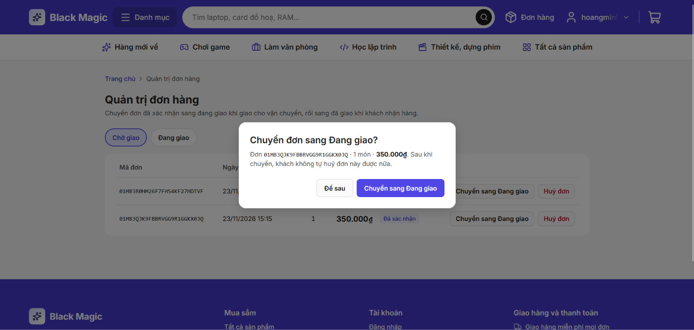
*Figure 21. The confirmation dialog for moving to shipping.*

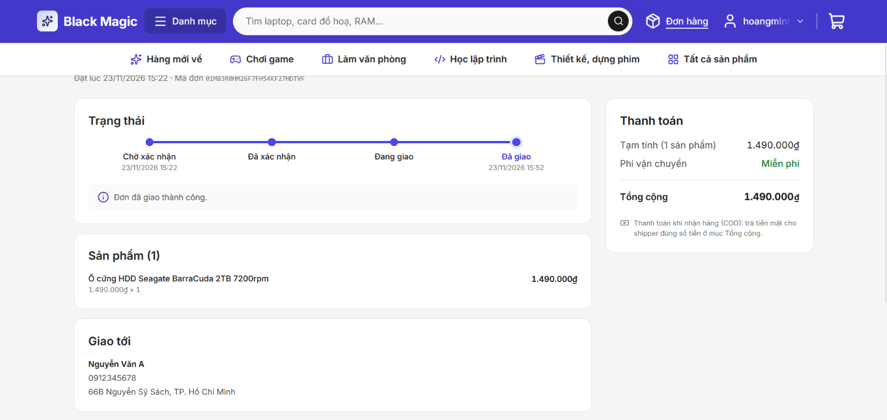
*Figure 22. The customer's order detail page showing "Đã giao".*

**Check the permission:** call the admin API with the token of an account **not** in the `admin` group:

```bash
curl -s -o /dev/null -w "%{http_code}\n" "$API/api/v1/admin/orders?status=CONFIRMED" -H "Authorization: Bearer $TOKEN_CUSTOMER"
```

It returns `403`. Without a token, `401`. The permission is checked in the backend from the groups in the JWT, not by whether the web app shows a button.

## Cost of this part

Measured on the author's sandbox account, running the lab from 22 to 24/11/2026: Cost Explorer (Credits excluded) shows 0 USD for every service, within the free tier. Running the lab for a few hours and then deleting it costs almost nothing; if you leave the stacks running for long, check Billing again.

| Service | Use in this part | Measured in the lab |
|---|---|---|
| Lambda `ordering`, `order-processor`, admin | A few dozen invocations in the lab | $0 (within the free tier) |
| DynamoDB `carts`, `orders`, `order-idempotency` | On-demand, a few hundred reads and writes; `orders` has point-in-time recovery | $0 (within the free tier) |
| SQS orders queue and DLQ | A few dozen messages | $0 (within the free tier) |
| SES | A few emails (sandbox) | $0 (within the free tier) |
| SNS `order-confirmed` | A few messages | $0 (within the free tier) |

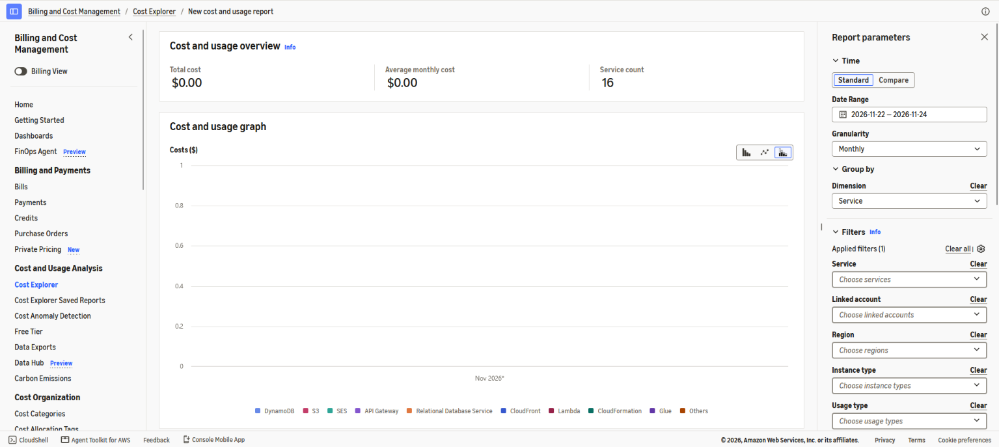
*Figure 23. Cost Explorer, **Group by: Service** as in 5.2.*

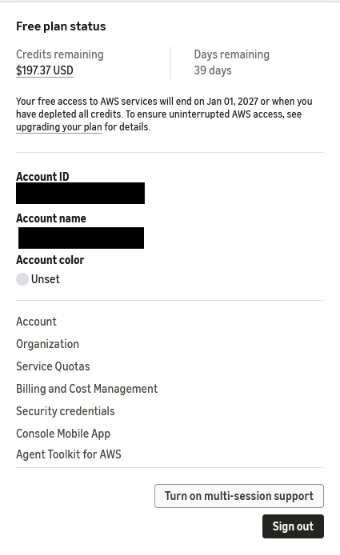
*Figure 23b. Free plan page: the account is still on the free plan.*

## Clean up

All sales-flow resources (tables `carts`, `orders`, `order-idempotency`, the orders queue and its DLQ, the three Lambdas, log groups, the `admin` group in the user pool) belong to the `shop-sbx-<name>-api` stack and are deleted with it, so follow **5.7 Clean up**.

Two things are outside the stack and must be removed separately:

- The SES identity created with the CLI:

  ```bash
  aws sesv2 delete-email-identity --email-identity <your email> --region ap-southeast-1
  ```

- The "Black Magic" entry in your phone's authenticator app (if you turned on two-factor authentication in step 8).

Check Billing the next day as in 5.7.
