# 5.4. Luồng bán hàng: giỏ hàng, đặt hàng không mất, không trùng

Người viết: Hoàng · Bản nháp 24/11/2026

Chương này hướng dẫn làm lại luồng bán hàng của shop-ai: thêm vào giỏ, đặt hàng có `Idempotency-Key`, đơn đi qua hàng đợi SQS tới worker xác nhận và gửi email SES, khách huỷ đơn thì hoàn kho, admin chuyển trạng thái giao hàng. Trọng tâm là hai câu hỏi: **đơn có bị mất khi một phần hệ thống lỗi không**, và **bấm đặt hai lần có ra hai đơn không**. Cần làm xong 5.1 Introduction, 5.2 Prerequisite và 5.3 Hạ tầng trước: stack sandbox `shop-sbx-<tên>-api` và `shop-sbx-<tên>-web` đã deploy vào tài khoản của bạn. Trong chương này `<tên>` là tên bạn dùng ở `-c owner=<tên>` khi deploy.

## Mục tiêu

Sau chương này bạn sẽ:

- Hiểu đường đi của một đơn: web → API Gateway → Lambda `ordering` → DynamoDB (một giao dịch) → SQS → Lambda worker → SES và SNS.
- Thấy được vì sao đơn không bị trừ kho sai: trừ kho, ghi đơn, bỏ món khỏi giỏ nằm trong **một** `TransactWriteItems`, mỗi lệnh trừ kho có điều kiện `stock >= quantity`.
- Thử `Idempotency-Key`: gửi lại cùng khoá thì nhận lại đúng đơn cũ, không có đơn thứ hai.
- Tắt worker một lúc rồi bật lại để thấy đơn vẫn nằm chờ trong hàng đợi, không mất.
- Huỷ đơn để thấy kho được cộng lại đúng một lần, và chuyển trạng thái giao hàng bằng tài khoản admin.

## Kiến trúc phần bán hàng

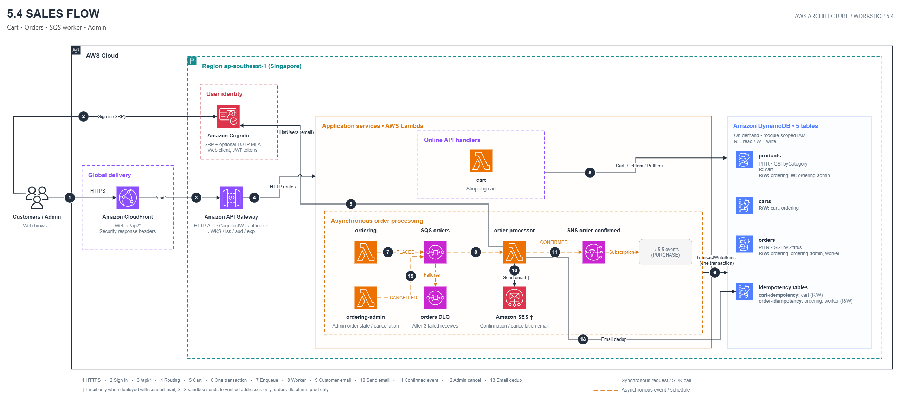
*Ảnh 01. Sơ đồ luồng bán hàng: Web (CloudFront) → API Gateway (JWT Cognito) → Lambda `ordering` → DynamoDB `products`, `carts`, `orders`, `order-idempotency` (một giao dịch) → SQS hàng đợi đơn (DLQ sau 3 lần lỗi) → Lambda `order-processor` → SES (email cho khách) và SNS `order-confirmed` → SQS của module `events`; Lambda admin đọc index `byStatus` của `orders`.*
[Nguồn draw.io](images/5.4/01-so-do.drawio)

| Thành phần | Dùng làm gì | Cấu hình đáng chú ý (`infra/lib/api-stack.ts`) |
|---|---|---|
| Bảng `carts` | Mỗi khách một giỏ (khoá `userId`), danh sách món trong một item | On-demand; ghi có điều kiện `version` để hai tab sửa giỏ không đè nhau |
| Bảng `orders` | Đơn hàng (khoá `userId` + `orderId` dạng ULID) | Index `byStatus` cho admin; cùng bảng có item bộ đếm `#OPEN` (tối đa 3 đơn đang mở) và item đánh dấu `#KEY#<Idempotency-Key>` có TTL `expiresAt`; bật point-in-time recovery |
| Bảng `order-idempotency` | Bản ghi chống xử lý hai lần của Powertools Idempotency | Khoá `id`, TTL `expiration` (24 giờ) |
| Lambda `ordering` | `POST/GET /api/v1/orders`, `GET/DELETE /api/v1/orders/{orderId}` | 512 MB, timeout 10 giây, chỉ được ghi đúng các bảng nó cần |
| Hàng đợi đơn (SQS) | Đơn vừa tạo, đơn vừa huỷ chờ worker xử lý | Mã hoá SQS, chỉ nhận TLS, visibility timeout 60 giây, lỗi **3 lần** thì sang DLQ (giữ 14 ngày) |
| Lambda `order-processor` (worker) | Xác nhận đơn, gửi email, gửi tin `order-confirmed` | 256 MB, timeout 10 giây, mỗi lần nhận tối đa 5 tin, báo lỗi từng tin (`reportBatchItemFailures`), chạy tối đa 2 bản cùng lúc (giữ nhịp cho SES sandbox) |
| Lambda admin | `GET/PATCH/DELETE /api/v1/admin/orders…` | Chỉ nhóm Cognito `admin` gọi được (backend kiểm, trả 403 nếu không phải) |

Máy trạng thái của đơn (`docs/business/ordering.md`):

```text
PENDING ──► CONFIRMED ──► SHIPPED ──► DELIVERED
   │            │            │
   └────────────┴────────────┴──► CANCELLED (hoàn kho)
```

`PENDING` do API đặt, `CONFIRMED` do worker, `SHIPPED` và `DELIVERED` do admin. Khách huỷ được khi `PENDING` hoặc `CONFIRMED`; admin huỷ được thêm khi `SHIPPED`.

## Chuẩn bị

- Đã làm 5.2 Prerequisite (AWS CLI, Node, pnpm, repo shop-ai) và 5.3 (hai stack sandbox đã deploy).
- Một tài khoản đã đăng ký trên web của bạn (URL ở output `WebUrl` của stack `shop-sbx-<tên>-web`).
- `jq` để đọc JSON trong các lệnh dưới (Git Bash trên Windows: tải `jq` từ trang chính thức và thêm vào `PATH`).
- Lấy các output cần dùng của stack API:

```bash
STACK=shop-sbx-<tên>-api
aws cloudformation describe-stacks --stack-name "$STACK" \
  --query "Stacks[0].Outputs[?OutputKey=='ApiUrl' || OutputKey=='OrdersTableName' || OutputKey=='OrdersQueueUrl' || OutputKey=='UserPoolId' || OutputKey=='UserPoolE2eClientId'].[OutputKey,OutputValue]" \
  --output text \
  | sed -E 's/[0-9]{12}/<account-id>/g; s/(ap-southeast-1_)[A-Za-z0-9]+/\1xxxxxxxx/g' \
  | awk -F'\t' '{printf "%-21s %s\n", $1, $2}'
```

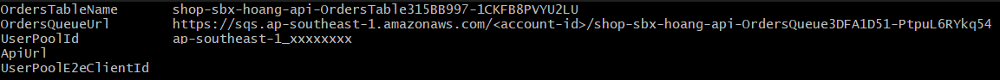
*Ảnh 02. Output của stack API; lệnh đã thay account ID bằng `<account-id>` và che ID user pool.*

### Bật email SES cho worker

Worker chỉ gửi email khi lúc deploy có truyền địa chỉ gửi (`-c senderEmail`); không truyền thì worker bỏ bước email, các bước khác vẫn chạy. Tài khoản SES mới ở **sandbox**: chỉ gửi được tới địa chỉ đã xác minh, tối đa 1 thư mỗi giây. Cách đơn giản nhất cho lab là dùng **cùng một địa chỉ** làm địa chỉ gửi và email đăng ký tài khoản trên web.

1. Xác minh địa chỉ (không tạo bằng CDK vì identity dùng chung cả tài khoản; xoá stack thì mất):

   ```bash
   aws sesv2 create-email-identity --email-identity <email của bạn> --region ap-southeast-1
   ```

   Mở hộp thư, bấm link xác minh của AWS.
2. Console → **Amazon SES** → **Identities**: địa chỉ ở trạng thái **Verified**.
3. Build web rồi deploy lại stack API kèm địa chỉ gửi:

   ```bash
   pnpm --filter web build
   pnpm --filter infra exec cdk deploy shop-sbx-<tên>-api -c env=sbx -c owner=<tên> -c senderEmail=<email của bạn>
   ```

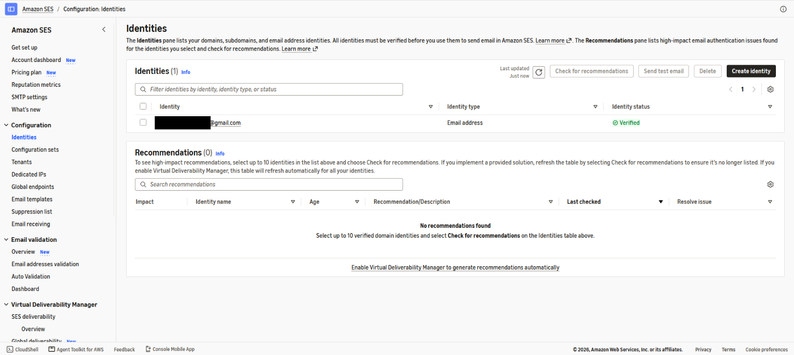
*Ảnh 03. Identity ở trạng thái Verified trong SES.*

## Bước 1: Thêm vào giỏ

**Mục tiêu:** thấy giỏ của tài khoản được lưu ở server, và giỏ của khách chưa đăng nhập được gộp vào khi đăng nhập.

1. Mở web **chưa đăng nhập**, vào một sản phẩm còn hàng, bấm **Thêm vào giỏ**. Giỏ khách nằm trong trình duyệt (localStorage).
2. Đăng nhập. Web gọi `POST /api/v1/cart/merge` (có `Idempotency-Key`) để gộp giỏ khách vào giỏ tài khoản, rồi xoá giỏ khách.
3. Thêm một sản phẩm khác, mở **Giỏ hàng**.

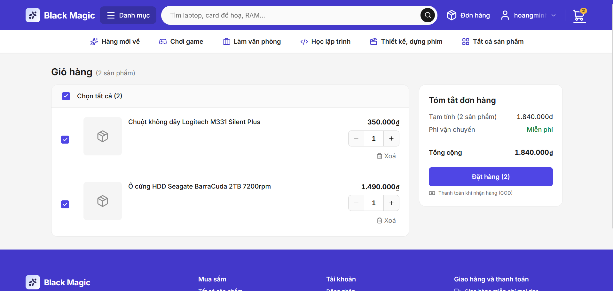
*Ảnh 04. Trang giỏ hàng có 2 sản phẩm, đã đăng nhập.*

**Kiểm tra:** Console → **DynamoDB** → bảng `...CartsTable...` của stack `shop-sbx-<tên>-api` → **Explore items**. Có một item với `userId` là `sub` Cognito của bạn, thuộc tính `items` là danh sách `{ productId, quantity, addedPrice, addedAt }` và `version`.

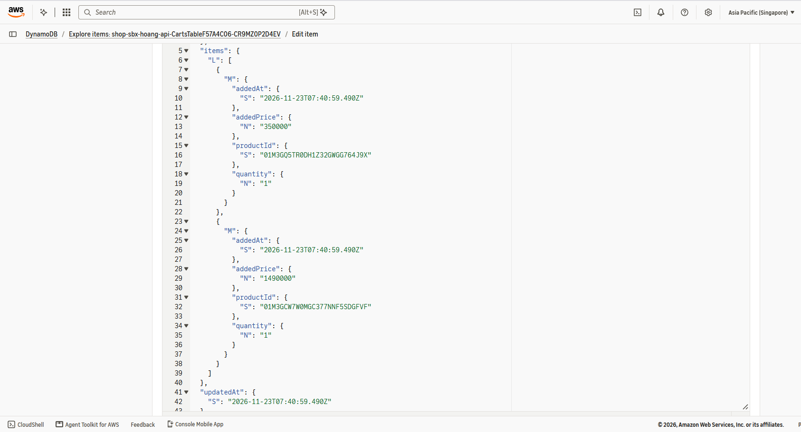
*Ảnh 05. Item giỏ trong bảng `carts`.*

## Bước 2: Đặt hàng

**Mục tiêu:** tạo một đơn và xem một giao dịch DynamoDB ghi những gì.

1. Ở giỏ, tick 1 sản phẩm (để món kia lại), bấm **Đặt hàng**. Trang đặt hàng hiện món đã chọn, phí vận chuyển "Miễn phí".
2. Điền họ tên, số điện thoại, địa chỉ, tỉnh/thành (dữ liệu giả), bấm **Xác nhận đặt hàng**.
3. Web chuyển sang trang chi tiết đơn. Trạng thái đầu là "Chờ xác nhận" (`PENDING`), vài giây sau tải lại thì thành "Đã xác nhận" (`CONFIRMED`) do worker.

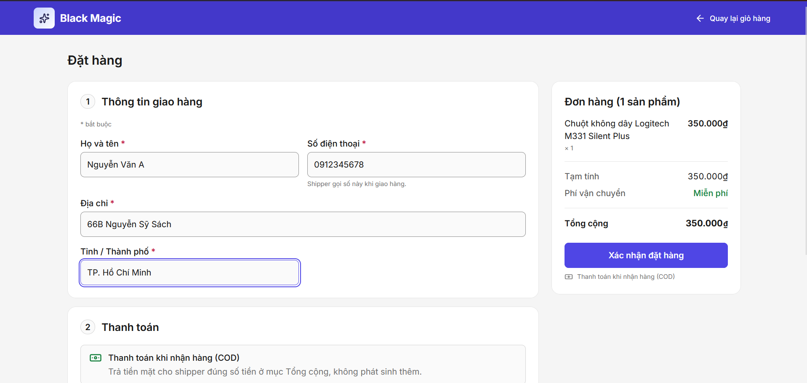
*Ảnh 06. Trang đặt hàng trước khi bấm xác nhận (dữ liệu giả).*

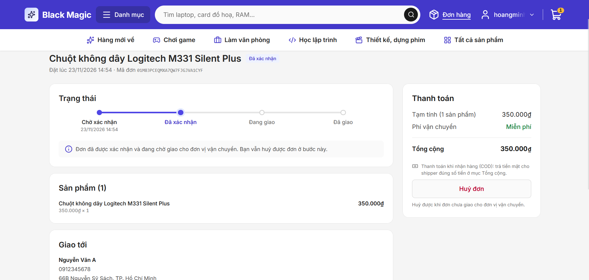
*Ảnh 07. Trang chi tiết đơn ở trạng thái "Đã xác nhận".*

**Kiểm tra trong DynamoDB:**

1. Bảng `...OrdersTable...` → **Explore items**, lọc `userId` = `sub` của bạn. Có ba loại item:
   - đơn (`orderId` là ULID, `status`, `items` là ảnh chụp tên, giá, số lượng lúc đặt, `totalAmount`, `shippingAddress`);
   - bộ đếm `#OPEN` với `openOrders` = 1 (số đơn đang mở, tối đa 3);
   - item đánh dấu `#KEY#<Idempotency-Key>` có `refOrderId` trỏ tới đơn và `expiresAt` (TTL 24 giờ).
2. Bảng `...ProductsTable...`: `stock` của sản phẩm vừa đặt đã giảm đúng số lượng.
3. Bảng `...CartsTable...`: chỉ món đã đặt bị bỏ khỏi giỏ; món không tick vẫn còn.

Các thay đổi này (trừ kho, ghi đơn, bỏ món khỏi giỏ, tăng `#OPEN`, ghi item đánh dấu) nằm trong **một** `TransactWriteItems`: hoặc tất cả cùng xảy ra, hoặc không có gì thay đổi. Lệnh trừ kho có điều kiện `stock >= quantity`, nên hai khách cùng mua món cuối cùng thì chỉ một người được, người kia nhận 409 `OUT_OF_STOCK` và kho không bao giờ âm.

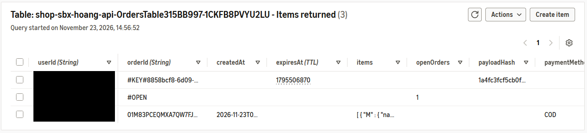
*Ảnh 08. Ba item trong bảng `orders`: đơn, `#OPEN`, `#KEY#…`.*

## Bước 3: Bấm hai lần vẫn một đơn (`Idempotency-Key`)

**Mục tiêu:** gửi cùng một yêu cầu đặt hàng hai lần với cùng `Idempotency-Key` và nhận lại đúng một đơn.

Web sinh một UUID cho mỗi lượt đặt hàng và gửi lại **đúng UUID đó** khi khách bấm lại sau lỗi mạng. Ta gọi thẳng API để thấy rõ.

1. Lấy access token bằng app client E2E (chỉ có ở sandbox, dev, staging; prod không có). Mật khẩu đọc bằng `read -s` để không lưu vào lịch sử lệnh:

   ```bash
   API=<ApiUrl>
   CLIENT=<UserPoolE2eClientId>
   read -rp "Email: " EMAIL; read -rsp "Mật khẩu: " PW; echo
   TOKEN=$(aws cognito-idp initiate-auth --region ap-southeast-1 --client-id "$CLIENT" \
     --auth-flow USER_PASSWORD_AUTH --auth-parameters "USERNAME=$EMAIL,PASSWORD=$PW" \
     --query AuthenticationResult.AccessToken --output text); unset PW
   ```

2. Chọn một sản phẩm còn hàng và giá hiện tại của nó:

   ```bash
   P=$(curl -s "$API/api/v1/products?limit=20" | jq -c '[.items[] | select(.stock > 0)][0] | {productId, price}')
   echo "$P"
   ```

3. Tạo thân yêu cầu và một khoá, rồi gửi **hai lần** với cùng khoá. Lệnh tạo khoá có thêm `command` để Git Bash không chạy `node` qua winpty (lấy kết quả vào biến sẽ lỗi):

   ```bash
   KEY=$(command node -e "console.log(crypto.randomUUID())")
   BODY=$(jq -n --argjson p "$P" '{
     items: [{ productId: $p.productId, quantity: 1, expectedPrice: $p.price }],
     shippingAddress: { fullName: "Khach Thu", phone: "0912345678", address: "1 Duong Thu", province: "Ha Noi" }
   }')
   for i in 1 2; do
     curl -s -w '\n%{http_code}\n' -X POST "$API/api/v1/orders" \
       -H "Authorization: Bearer $TOKEN" -H "Content-Type: application/json" \
       -H "Idempotency-Key: $KEY" -d "$BODY" |
       { read -r body; read -r code; echo "HTTP $code orderId=$(echo "$body" | jq -r .orderId)"; }
   done
   ```

**Kết quả đúng:** lần 1 trả `HTTP 201`, lần 2 trả `HTTP 200` với **cùng `orderId`**. Trong bảng `orders` chỉ có một đơn mới; `stock` chỉ giảm 1.

4. Gửi lại cùng khoá nhưng đổi `quantity` thành 2: trả `422` mã `IDEMPOTENCY_KEY_REUSED` (cùng khoá mà khác nội dung là lỗi của client, không tạo đơn).

   ```bash
   BODY2=$(echo "$BODY" | jq '.items[0].quantity = 2')
   curl -s -w '\n%{http_code}\n' -X POST "$API/api/v1/orders" \
     -H "Authorization: Bearer $TOKEN" -H "Content-Type: application/json" \
     -H "Idempotency-Key: $KEY" -d "$BODY2" |
     { read -r body; read -r code; echo "HTTP $code code=$(echo "$body" | jq -r .code)"; }
   ```

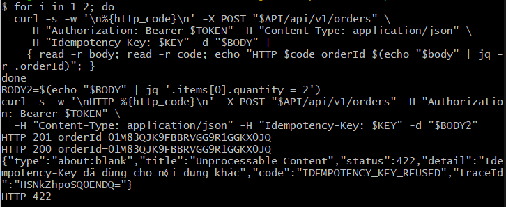
*Ảnh 09. Kết quả hai lần gửi (201 rồi 200, cùng `orderId`) và lần gửi khác nội dung (422).*

Cách server làm (ADR-0017, `docs/business/ordering.md` BR-04): Powertools Idempotency lưu kết quả theo khoá trong bảng `order-idempotency` 24 giờ; thêm vào đó, item đánh dấu `#KEY#…` được ghi **trong cùng giao dịch** với đơn, nên kể cả khi Lambda bị cắt ngay sau khi giao dịch thành công, lần gọi lại vẫn tìm ra đơn cũ thay vì tạo đơn mới.

> Bạn vừa tạo đơn thật trong sandbox. Huỷ nó ở bước 7 hoặc trên web (`/orders`) để trả kho. Mỗi tài khoản chỉ có tối đa 3 đơn đang mở; đơn thứ 4 nhận 409 `TOO_MANY_OPEN_ORDERS`.

## Bước 4: Giá đổi thì không tạo đơn

**Mục tiêu:** thấy server không tin giá client gửi lên.

Gửi lại yêu cầu ở bước 3 với `expectedPrice` khác giá thật và một khoá mới:

```bash
KEY=$(command node -e "console.log(crypto.randomUUID())")
BAD=$(echo "$BODY" | jq '.items[0].expectedPrice -= 1000')
curl -s -X POST "$API/api/v1/orders" -H "Authorization: Bearer $TOKEN" \
  -H "Content-Type: application/json" -H "Idempotency-Key: $KEY" -d "$BAD" | jq
```

**Kết quả đúng:** `409`, `code` là `PRICE_CHANGED`, `changedItems` có `expectedPrice` (giá bạn gửi) và `currentPrice` (giá thật). Không có đơn mới, kho không đổi. Trên web, trang đặt hàng hiện giá mới để khách xem rồi bấm xác nhận lại.

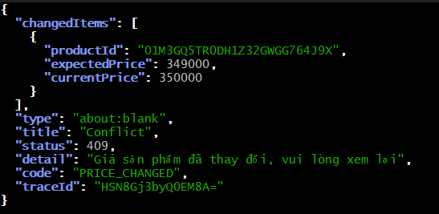
*Ảnh 10. Phản hồi 409 `PRICE_CHANGED`.*

Các mã lỗi nghiệp vụ khác của `POST /api/v1/orders` (cùng dạng `application/problem+json`):

| Mã | Khi nào |
|---|---|
| `OUT_OF_STOCK` (409) | Một món không đủ hàng hoặc ngừng bán, kèm `invalidItems` |
| `TOO_MANY_OPEN_ORDERS` (409) | Đã có 3 đơn `PENDING`/`CONFIRMED` |
| `ORDER_IN_PROGRESS` (409) | Lần gửi trước với cùng khoá chưa xong; gửi lại cùng khoá sau vài giây |
| `IDEMPOTENCY_KEY_REUSED` (422) | Cùng khoá, khác nội dung |
| (400) | Thiếu `Idempotency-Key` hoặc thân yêu cầu sai |

## Bước 5: Đơn không mất khi worker ngừng chạy

**Mục tiêu:** thấy SQS giữ đơn khi worker tạm ngừng, và worker xử lý tiếp khi bật lại.

API chỉ ghi đơn `PENDING` rồi đẩy tin `{ orderId, userId, type: "PLACED", correlationId }` vào hàng đợi (huỷ đơn thì `type` là `CANCELLED`); khách nhận phản hồi ngay, không chờ email. Worker xử lý sau.

1. Console → **Lambda** → hàm `shop-sbx-<tên>-api-OrderProcessorFunction…` → **Configuration** → **Triggers** → chọn trigger SQS → **Edit** → bỏ chọn **Activate trigger** → **Save**.
2. Đặt một đơn trên web. Trang chi tiết đơn giữ "Chờ xác nhận", tải lại vẫn vậy.
3. Console → **SQS** → hàng đợi `…-OrdersQueue…` → **Send and receive messages** → **Poll for messages**. Thấy một tin, mở ra: thân tin chỉ có `orderId`, `userId`, `type` (`PLACED`), `correlationId`, không có địa chỉ hay số điện thoại; `correlationId` còn nằm ở tab **Attributes** (message attribute).
   Lưu ý: poll làm tin bị ẩn 60 giây (visibility timeout); **không bấm Delete**.
4. Bật lại trigger (**Activate trigger** → **Save**). Trong vòng một phút, đơn sang "Đã xác nhận" và email xác nhận tới hộp thư.

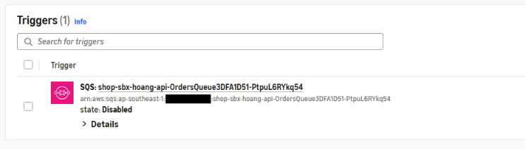
*Ảnh 11. Trigger SQS ở trạng thái Disabled.*

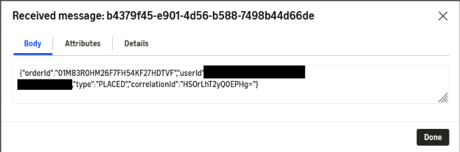
*Ảnh 12. Tin trong hàng đợi đơn khi worker đang tắt.*

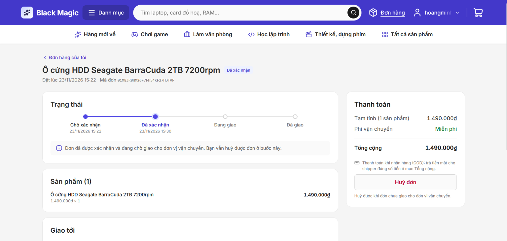
*Ảnh 13. Đơn chuyển "Đã xác nhận" sau khi bật lại trigger.*

**Kiểm tra log worker:** **CloudWatch** → **Logs Insights**, log group `…-OrderProcessorLogs…`:

```text
fields @timestamp, level, message, orderId
| filter correlationId = "<correlationId lấy từ tin ở bước 3>"
| sort @timestamp asc
```

Log có `correlationId` đi xuyên từ API sang worker; không có email, số điện thoại, địa chỉ.

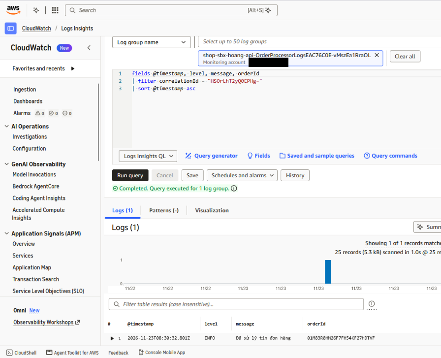
*Ảnh 14. Kết quả Logs Insights của worker.*

Nếu một tin lỗi 3 lần liên tiếp (vd. quyền IAM sai, SNS lỗi), SQS chuyển nó sang `…-OrdersDeadLetterQueue…` và đơn vẫn ở `PENDING`, không mất. Cách xử lý từng bước ở `docs/runbooks/dlq-orders.md`. Ở prod có alarm `orders-dlq` báo khi DLQ có tin.

## Bước 6: Email xác nhận gửi đúng một lần

**Mục tiêu:** thấy email xác nhận và cơ chế chống gửi trùng.

1. Mở hộp thư của địa chỉ đã xác minh: có email xác nhận với mã đơn, tên × số lượng, tổng tiền, thanh toán khi nhận hàng, miễn phí vận chuyển. Email cố ý không có họ tên, địa chỉ, số điện thoại, không có link.
2. Bảng `...OrderIdempotencyTable...` → **Explore items**: có item mới với `id` bắt đầu bằng tên hàm worker (`…OrderProcessorFunction…`), `status` = `COMPLETED` và `expiration` (24 giờ sau). Khoá chống trùng của email là `userId` cùng `<orderId>#CONFIRMED`; Powertools lưu khoá dưới dạng chuỗi băm nên trong `id` không đọc ra mã đơn. SQS giao tin "ít nhất một lần", nên worker có thể nhận cùng một tin hai lần; lần sau thấy bản ghi `COMPLETED` này thì không gửi lại email.

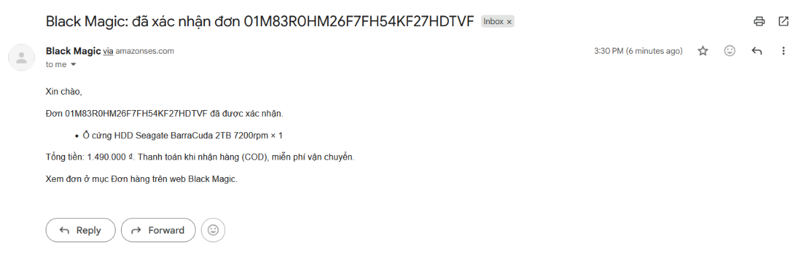
*Ảnh 15. Email xác nhận đơn.*

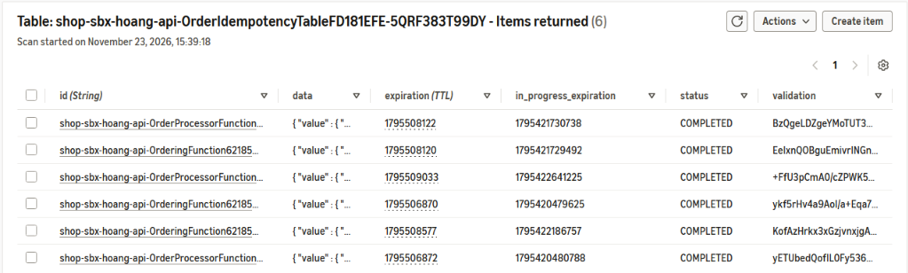
*Ảnh 16. Item của worker trong bảng `order-idempotency` (`id` bắt đầu bằng `…OrderProcessorFunction…`, `status` = `COMPLETED`).*

Worker làm theo thứ tự (`docs/business/ordering.md`, luồng SQS):

1. Đổi `PENDING → CONFIRMED` bằng ghi có điều kiện `status = PENDING` (đơn đã huỷ thì bỏ qua).
2. Gửi tin `order-confirmed` lên SNS (chỉ `orderId`, `userId`, thời điểm xác nhận, `productId` và số lượng) cho module gợi ý ghi lượt mua.
3. Gửi email qua SES, chống trùng bằng Powertools Idempotency.

SES từ chối (vd. địa chỉ nhận chưa xác minh trong sandbox) thì worker ghi log mức warn và metric `OrderEmailRejected`, không thử lại, không đẩy tin vào DLQ: đơn vẫn được xác nhận bình thường.

## Bước 7: Huỷ đơn, hoàn kho đúng một lần

**Mục tiêu:** thấy huỷ đơn trả kho trong cùng giao dịch và không trả hai lần.

1. Web → **Đơn hàng** → mở đơn đang "Đã xác nhận" → **Huỷ đơn** → xác nhận trong hộp thoại.
2. Đơn sang "Đã huỷ". Vài giây sau có email báo huỷ (worker gửi, khoá chống trùng `<orderId>#CANCELLED`).
3. Kiểm tra: `stock` trong `products` đã cộng lại; `openOrders` trong item `#OPEN` giảm 1.
4. Gọi huỷ lần nữa bằng API:

   ```bash
   curl -s -X DELETE "$API/api/v1/orders/<orderId>" -H "Authorization: Bearer $TOKEN" | jq
   ```

   Trả `409` mã `CANNOT_CANCEL`; kho không được cộng thêm lần nữa (giao dịch huỷ có điều kiện trạng thái hiện tại).

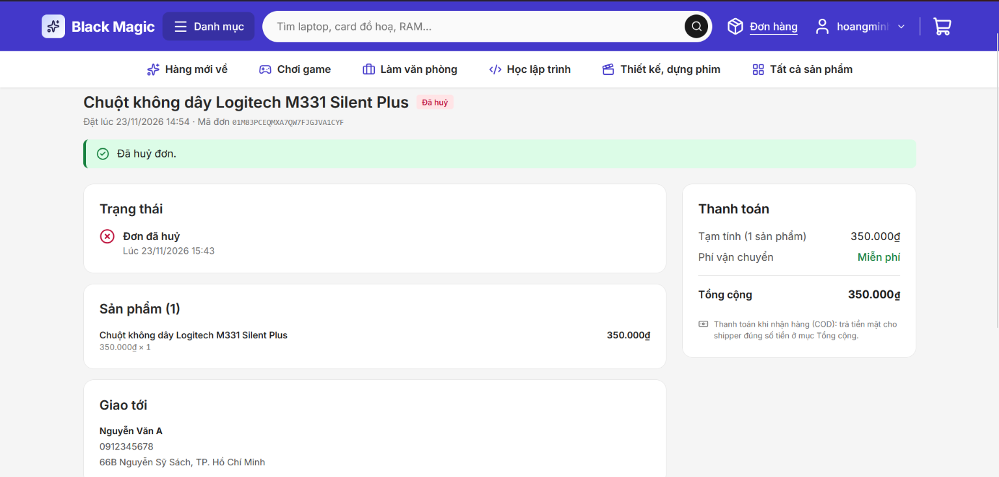
*Ảnh 17. Trang chi tiết đơn đã huỷ.*

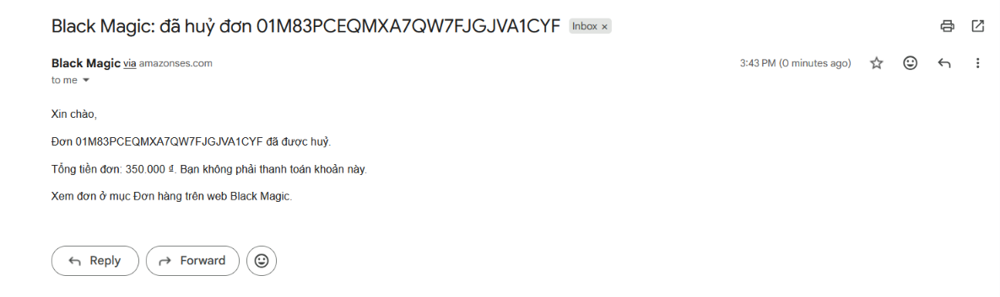
*Ảnh 18. Email báo huỷ đơn.*

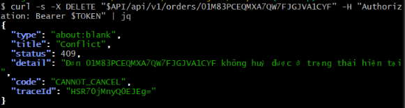
*Ảnh 19. Phản hồi 409 `CANNOT_CANCEL` khi huỷ lần hai.*

## Bước 8: Admin chuyển trạng thái giao hàng

**Mục tiêu:** dùng tài khoản admin chuyển đơn `CONFIRMED → SHIPPED → DELIVERED`.

1. Thêm tài khoản của bạn vào nhóm `admin` (nhóm có sẵn trong user pool):

   ```bash
   aws cognito-idp admin-add-user-to-group --region ap-southeast-1 \
     --user-pool-id <UserPoolId> --username <email của bạn> --group-name admin
   ```

   Nếu lệnh báo `UserNotFoundException`, dùng `userId` (`sub` của tài khoản) thay cho email ở `--username`.

2. Đăng xuất rồi đăng nhập lại trên web để token mới có nhóm `admin`. Menu tài khoản hiện "Trang quản trị".
3. Mở `/admin`. Tài khoản admin phải bật xác thực hai lớp: chưa bật thì web chuyển sang trang bật, làm theo hướng dẫn trên trang (quét mã QR bằng ứng dụng xác thực) rồi quay lại `/admin`.
4. Đặt một đơn mới bằng tài khoản thường (hoặc chính tài khoản này), chờ "Đã xác nhận".
5. Tab **Chờ giao** → **Chuyển sang Đang giao** → xác nhận. Đơn sang tab **Đang giao**; `openOrders` giảm 1 (hàng đã rời kho, khách đặt thêm được).
6. Tab **Đang giao** → **Đã giao**. Khách mở đơn thấy "Đã giao".

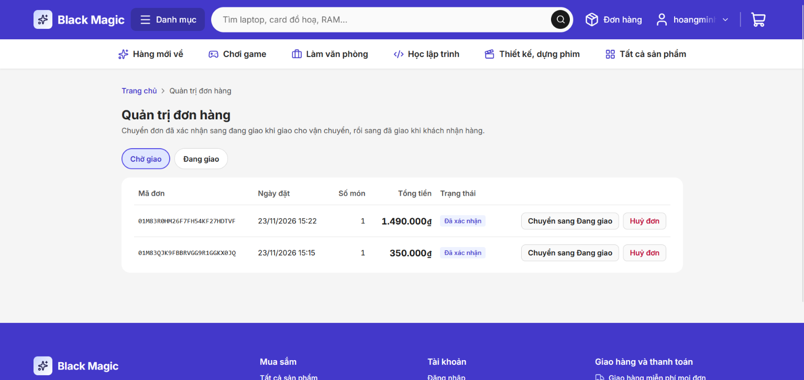
*Ảnh 20. Trang `/admin`, tab Chờ giao, có đơn vừa xác nhận.*

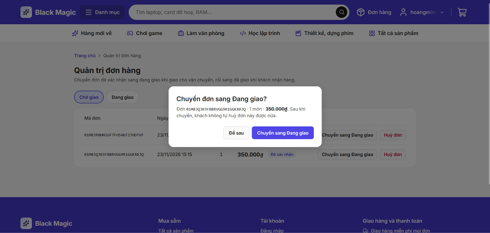
*Ảnh 21. Hộp thoại xác nhận chuyển sang Đang giao.*

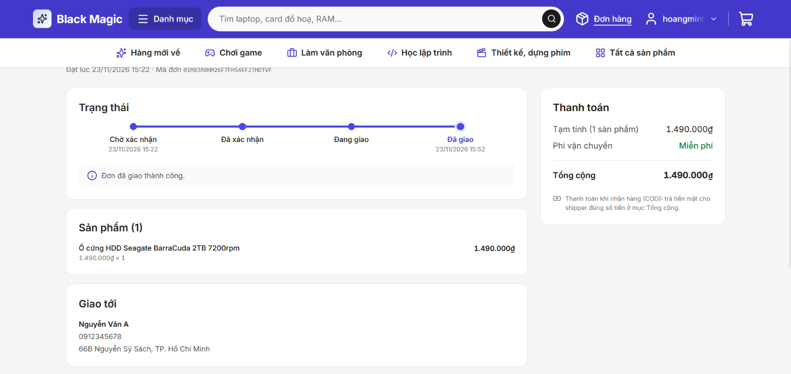
*Ảnh 22. Trang chi tiết đơn phía khách ở trạng thái "Đã giao".*

**Kiểm tra quyền:** gọi API admin bằng token của một tài khoản **không** thuộc nhóm `admin`:

```bash
curl -s -o /dev/null -w "%{http_code}\n" "$API/api/v1/admin/orders?status=CONFIRMED" -H "Authorization: Bearer $TOKEN_KHACH"
```

Trả `403`. Không có token thì `401`. Quyền kiểm ở backend theo nhóm trong JWT, không dựa vào việc web có hiện nút hay không.

## Chi phí phần này

Số đo trên tài khoản sandbox của người viết, chạy lab từ 22 đến 24/11/2026: Cost Explorer (đã bỏ Credit) ghi 0 USD cho mọi dịch vụ, nằm trong mức miễn phí. Lab chạy vài giờ rồi xoá thì gần như không tốn tiền; nếu để stack chạy lâu, xem lại Billing.

| Dịch vụ | Dùng trong phần này | Số đo trong lab |
|---|---|---|
| Lambda `ordering`, `order-processor`, admin | Vài chục lần gọi trong lab | $0 (trong mức miễn phí) |
| DynamoDB `carts`, `orders`, `order-idempotency` | On-demand, vài trăm lần đọc ghi; `orders` bật point-in-time recovery | $0 (trong mức miễn phí) |
| SQS hàng đợi đơn và DLQ | Vài chục tin | $0 (trong mức miễn phí) |
| SES | Vài email (sandbox) | $0 (trong mức miễn phí) |
| SNS `order-confirmed` | Vài tin | $0 (trong mức miễn phí) |

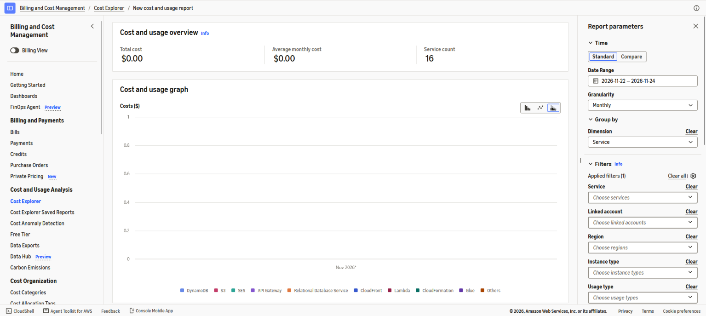
*Ảnh 23. Cost Explorer, **Group by: Service** như 5.2.*

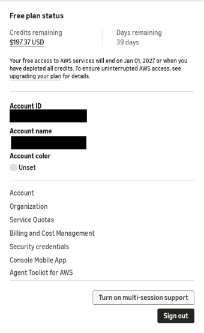
*Ảnh 23b. Trang Free plan: tài khoản còn trong gói miễn phí.*

## Clean up

Mọi tài nguyên của phần bán hàng (bảng `carts`, `orders`, `order-idempotency`, hàng đợi đơn và DLQ, ba Lambda, log group, nhóm `admin` trong user pool) nằm trong stack `shop-sbx-<tên>-api` và xoá theo stack, nên làm theo **5.7 Clean up**.

Hai thứ không thuộc stack, xoá riêng:

- Identity SES tạo bằng CLI:

  ```bash
  aws sesv2 delete-email-identity --email-identity <email của bạn> --region ap-southeast-1
  ```

- Mục "Black Magic" trong ứng dụng xác thực trên điện thoại (nếu đã bật xác thực hai lớp ở bước 8).

Hôm sau kiểm tra Billing như 5.7.
